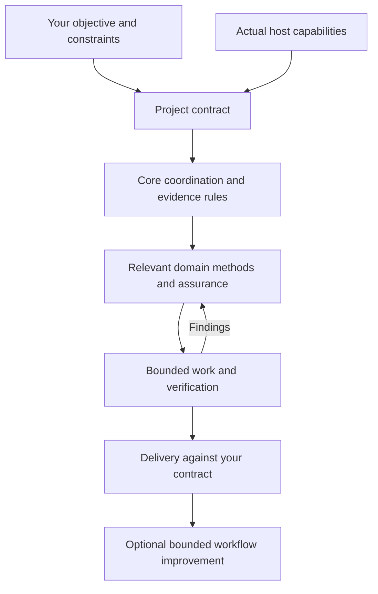

# Using the general workflow

Use one loading tier with your own project request. [COMPACT_PROMPT.md](COMPACT_PROMPT.md) suits small-context models and quick tasks. The modular files suit agents with file access. [MASTER_PROMPT.md](MASTER_PROMPT.md) suits large-context models without file access. See [HOST_ADAPTERS.md](HOST_ADAPTERS.md) for choosing a tier. The same prompt can guide a new app, a library repair, a research report, a data analysis or another supported deliverable. It first determines what applies; it does not copy requirements from an example project.

## What is universal and what is selected

The core preserves scope, permissions, evidence integrity, appropriate separation and honest completion. The project chooses its domain requirements and applicable gates. The environment supplies actual tools. UI/design methods apply to human-facing work; a backend task does not acquire a UI requirement. A document does not acquire an app build or signing requirement.

“Model-independent” means that no rule relies on a particular model family, vendor, reasoning mode or tool-call format. The agent adapts to the capabilities it observes, and a smaller model uses the compact tier. Model behavior still differs, so rerun a few evaluation scenarios when you change model or host. “Environment-independent” means the protocol names capabilities rather than vendor commands. It cannot give a text-only model filesystem access, turn one conversation into independent reviewers, or supply missing equipment. “Project-independent” means no fixed product scope or platform gates. It does not mean that domain knowledge and valid evaluation are unnecessary.

## Launch

Give the receiving agent the chosen tier and a concrete request such as:

> Apply the attached Adaptive Agent Workflow to this project: [objective and deliverables]. Use these authorized inputs/workspace: [details]. Preserve this scope: [requirements]. Reuse the existing process where suitable. Select the relevant domain profiles and assurance based on actual risk. Complete the authorized work and report the evidence, limitations and any required external blockers.

Keep project facts in the project's own contract and instruction files, not in this package, so one copy of the workflow can serve many projects. Supply material constraints and permissions you already know. You do not need to fill every template field manually: the agent should inspect and infer routine details, then ask only for consequential missing information. Merely asking to review this prompt does not authorize project execution.

During adoption, use [WORKFLOW_CONFIGURATION.md](WORKFLOW_CONFIGURATION.md) to keep standing instructions short, select procedures on demand and verify any claimed mechanical enforcement. It includes a standing-rule excerpt and skill packaging guidance. For material UI polish or audit, use [UI_REVIEW_PLAYBOOK.md](UI_REVIEW_PLAYBOOK.md): establish readiness and supported states, inspect pixels plus semantics and outcomes, fix concrete findings within a declared budget, and preserve user edits during recovery. Tool-specific commands and design-system values belong in the adopting project.

The master embeds the template, core, agent interaction protocol, composition, domain profiles, UI design protocol, UI review playbook, host adaptation, workflow configuration, improvement protocol and practical playbooks. GLOSSARY.md stays a separate lookup file. Alternatively, provide WORKFLOW.md and PROJECT_TEMPLATE.md with only relevant modules. Do not paste both forms. Keep a durable requirement ledger for long projects; do not drop scope to fit a context window.

For detailed operation, use [PRACTICAL_PLAYBOOKS.md](PRACTICAL_PLAYBOOKS.md): O1 for role inputs and independent assessment, O2 for the nine engineering scenarios, O3 for evidence/task records, O4 for testing the checks themselves, O5 for optional integrations and operational handoff, and O6 for judgment bias checks, multi-agent failure clusters and practice detail. Only use the sections relevant to the task. The playbooks strengthen execution detail without imposing the older workflow's fixed agent roster or software-only completion rules.

Use this consolidated package alone. The earlier pragmatic package is a source, and the review folder is a synthetic example. Loading all three as simultaneous instructions would reintroduce contradictions. [MERGE_DECISIONS.md](MERGE_DECISIONS.md) records the selective merge.

## Choose a way of working

Defaults suit most work: the agent works end to end, asks before consequential decisions, reports at milestones and uses as much procedure as the task needs. To change that, name a participation preset, a workflow preset or a few keys from [COMPOSITION.md](COMPOSITION.md). Each workflow preset changes one dimension only:

> Co-creation participation; keep reports terse.

> Tutoring participation: I want to write the analysis myself, give me hints and check my work.

> Unattended preset with a budget of two hours; defer anything that needs my decision.

Who does each stage, how often the agent reports, and how much procedure it uses are separate settings, and minimal procedure never puts non-routine work on the fast path. None of them lowers assurance, removes a consequence gate or relaxes a mandatory invariant. If the host cannot provide something requested, the agent says so at the start; when it was required, such as a separate reviewer, the affected acceptance waits rather than being skipped.

## How it adapts

| Example request | Relevant work | What is not imposed |
|---|---|---|
| Fix an API pagination bug | Existing baseline, reproduction, focused repair, compatibility/regression review | UI, mobile hardware, new framework |
| Build a desktop editor | Software plus UI methods, actual target/runtime and accessibility target | A different product's catalogue or input method |
| Analyse a dataset | Provenance, transformations, assumptions, controls and uncertainty | An app or public dashboard |
| Produce a research brief | Scope, primary sources, counterevidence and claim checking | Code, device testing or release signing |
| Correct a small document error | Core §0 fast path: focused factual/editorial check | A standing multi-agent council or contract paperwork |
| Change production infrastructure | Exact target, impact, rehearsal, recovery and authorized state change | Implied deployment permission from a template |

Classify the task as routine, material or consequential; that sets the lightweight, standard or high-consequence assurance floor before acceptance. Simple reversible work may finish with first-party checks; material changes normally receive fresh-context review. Required independence remains required if the host cannot provide it. Mandatory project gates cannot be marked irrelevant merely because they are unavailable.

Native subagents are optional. Sequential fresh sessions can provide independent review. The same model may fill different responsibilities in separate contexts; different model names do not automatically establish independence. A coordinator who also makes a change is first-party for that change.

## Resume and integrate

Ask for a factual handoff identifying the contract/workflow revision, artifact baseline, actual evidence, findings, permissions and next ready task. A receiving environment rechecks reality and capability limits. Evidence may survive a session change when its dependencies remain valid. New input or changed artifacts require affected checks again.

GitHub or another collaboration service can be added later. Tasks, artifacts and evidence exist independently of remote accounts. Integration does not change the project's acceptance rules or automatically authorize publication.

## Improve without endless process growth

Use [CONTINUOUS_IMPROVEMENT.md](CONTINUOUS_IMPROVEMENT.md): start from an observed weakness, research alternatives, trial a bounded change against the current version, compare quality and effort, and adopt/reject/mark inconclusive. Protect acceptance cases from repeated tuning. Test more than one task family and host capability mode before claiming broad empirical portability.

The current package has document and scenario-inspection checks, not a completed cross-project benchmark. [RESEARCH_AND_CHANGES.md](RESEARCH_AND_CHANGES.md) records both research cycles and deliberate limitations. The optional [evaluation/SCENARIOS.md](evaluation/SCENARIOS.md) contains public development cases for future trials.
